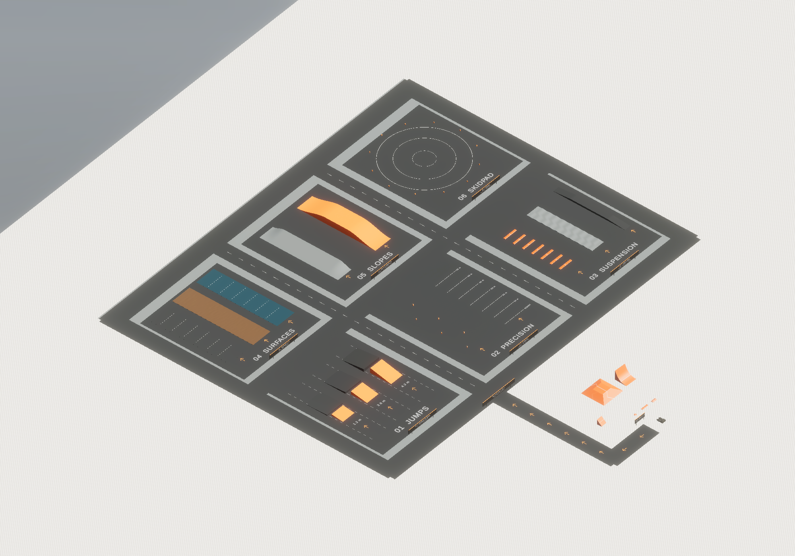

# Tumbler Sandbox — Unity

A personal Unity sandbox for learning and experimenting with vehicle gameplay. Drive a Tumbler inspired by the Batmobile from *Batman Begins*, explore a physics playground, and experiment with different drivetrain modes.

This repository (`tumbler-sandbox`) is a learning project, not a finished commercial game. The project includes a six-zone driving test ground in Sandbox. Unity Editor checks cover the new colliders and per-surface wheel grip; manual driving and player-build validation remain separate checks.

`main` is the maintained branch. The lighting, stealth, turbo-reserve and equipment update is available separately on `feat/tumbler-lighting-stealth-and-detail` for manual review before integration. See the [equipment and night-systems guide](docs/tumbler-night-systems.md).

## Features

- Rigidbody and WheelCollider vehicle physics, with wheel mesh updates, speed-dependent steering and downforce.
- Xbox controller and keyboard bindings for every driving action, including WASD and arrow-key driving.
- Finite boost reserve with forward impulses, particles and jet audio; delayed recharge is faster in the air.
- Eight textured headlights with off/low/high states and actual HDRP volumetric spot beams.
- Reversible Bat stealth mode that conceals vehicle lights, turbine particles and brake glow, and mutes engine audio while preserving driving controls.
- Six ventilated gray brake discs, fixed calipers and progressive red incandescence based on each wheel's applied brake torque. Service braking heats all six; handbraking heats the rear four.
- Switchable AWD, FWD and RWD, seven automatic forward gears and a 260 km/h forward governor.
- Speed-sensitive steering with full parking lock and a retained steering allowance at high speed.
- Vehicle reset and low-speed upright recovery.
- Engine startup, idle and RPM-synchronous running audio with pitch drops on upshifts; handbrake tire sounds and contact-based tire smoke.
- Subtle surface-projected tire marks during braking and lateral sliding, with independent wheel contact and gradual fading.
- Stable, scene-local fixed exposure in Sandbox and consistent Main Menu option colors.
- Compact bottom-right digital speed, gear/reverse, drivetrain and RPM instruments, with a green-to-red tachometer, boost reserve and light/handbrake/stealth indicators.
- Main menu and Sandbox scenes, with a Cinemachine camera setup.
- Six signed driving-test zones: progressive jumps, slalom/braking, suspension, surface grip, slopes and a skidpad.
- Original Tumbler geometry with additive floor relief and service lines, a narrower front subframe that clears steering, textured tires/rims, detailed interior pressure tanks and bronze fuel caps.

## Tech stack

| Technology | Repository version / use |
| --- | --- |
| Unity 6 | **6000.6.7f1**, revision `b22767f04f04` |
| C# | MonoBehaviour components and Unity events |
| Input System | **1.20.1**, `Gameplay` action map and generated `TumblerInput` wrapper |
| HDRP | **17.6.0**, active render pipeline |
| Cinemachine | **6.6.0**, camera components serialized in Sandbox |
| Unity UI / TextMeshPro | uGUI **2.6.0**, menu and driving HUD |

Versions come from `ProjectSettings/ProjectVersion.txt` and `Packages/manifest.json`. HDRP is the only installed render pipeline; Graphics Settings selects its existing asset and all quality levels inherit that selection. Unused URP and legacy Postprocessing packages, configurations and exclusive demo resources were removed after reference auditing. Other installed packages are not evidence of implemented gameplay features. The versions above reflect the Unity upgrade already present in the project; the driving-test-ground change does not alter packages or project settings.

## Getting started

Requirements: Git, Unity Hub, Unity Editor **6000.6.7f1**, an HDRP-capable graphics environment, and a keyboard or an Xbox controller recognized by Unity as a Gamepad. Physical hardware and operating-system compatibility have not been verified in this environment.

1. Clone the repository:

   ```sh
   git clone https://github.com/ignabelitzky/tumbler-sandbox.git
   cd tumbler-sandbox
   ```

2. Install Unity **6000.6.7f1** through Unity Hub. If it is not listed, use Hub's link to the Unity download archive.
3. In Hub, choose **Add project from disk**, select this repository's root, and open it with that exact Editor version.
4. Allow Package Manager resolution and the first asset import to finish. The initial download/import includes large binary source assets.
5. Open `Assets/_Project/Scenes/Main Menu.unity` and press **Play**, then use the menu to load Sandbox. For direct driving, open `Assets/_Project/Scenes/Sandbox.unity` and press **Play**.
6. Use the keyboard immediately, or connect an Xbox controller and use the mapping below. No input-mode selection is required.

Keep `Assets` and its `.meta` files, both package manifests, and `ProjectSettings` together. Avoid opening with a newer Editor unless you intend to perform a separate, reviewed upgrade. A player build has not been validated; see [validation and existing issues](docs/repository-audit.md).

## Controls — Xbox and keyboard

Bindings come from [TumblerInput.inputactions](Assets/_Project/Input/TumblerInput.inputactions). Xbox uses Unity's `<Gamepad>` layout, including XInput-derived Xbox devices. This avoids limiting the bindings to the Windows-specific XInput family.

| Action | Xbox controller | Keyboard |
| --- | --- | --- |
| Steering | Left Stick, horizontal axis | A / D or Left / Right Arrow |
| Acceleration | RT | W or Up Arrow |
| Reverse | LT | S or Down Arrow |
| Boost | A | Left Shift |
| Cycle lights: off → low → high → off | D-pad Up | L |
| Toggle Bat stealth mode | Right Stick Click | V |
| Brake | B | Left Ctrl |
| Handbrake | X | Space |
| Upright recovery, below 1 m/s | Y | F |
| Cycle AWD → FWD → RWD → AWD | RB | E |
| Reset position, rotation, velocity and transmission | Left Stick Click | R |
| Quit / stop Editor Play mode | Start / Menu | Escape |

The Xbox triggers remain a signed analog throttle axis, and the stick retains analog steering. Keyboard throttle/steering are digital; opposing keyboard directions cancel. Reverse and brake remain separate controls. You can combine acceleration, steering, boost and handbrake, subject to the existing vehicle behavior. Drivetrain, gearbox, torque, suspension and control bindings are unchanged by the test ground. Only tire stiffness is scaled while each wheel touches a marked test surface, and the original stiffness is restored on exit.

Turbo lasts six seconds from full. Recharge starts 2.5 seconds after use, takes twelve seconds on the ground, and runs 2.5 times faster while no wheel is grounded. After exhausting the reserve, release the boost button before using it again. A fresh boost press exits stealth even when the reserve is empty. Stealth preserves the last light preset, restores it on exit, and ignores light-cycle presses while active. Brakes cool gradually; holding a brake while stationary does not heat the discs.

Both device types remain available together without exclusive control schemes. One scene PlayerInput dispatches recovery, reset, drivetrain and quit events; the vehicle and boost components continue polling their generated input wrappers. Other controllers may use the same Gamepad layout, but no physical compatibility claim is made for them.

## Sandbox driving test ground

Open `Assets/_Project/Scenes/Sandbox.unity`. From the spawn, follow the amber arrows to the left-hand access road and then north to the **DRIVING TEST GROUND** sign. The existing playground remains available.

| Zone | Tests |
| --- | --- |
| 01 — Progressive jumps | Three launch heights (1.2 / 2.6 / 4.2 m), gaps and landing ramps |
| 02 — Precision | Movable slalom markers and a straight with 10 m braking references |
| 03 — Suspension | Progressive speed bumps, alternating uneven ground and a narrow raised bridge |
| 04 — Surfaces | Parallel asphalt, rough gravel and wet low-grip lanes |
| 05 — Slopes | 12° cross slope and a 5.2 m hill with ascent and descent |
| 06 — Skidpad | Painted turning circles for steering, drifting and recovery tests |

The three comparison lanes change actual WheelCollider grip. The wet lane is a test profile, without a water simulation. See [test-ground layout, grip settings and validation](docs/driving-test-ground.md) for details.

## Tire marks and exposure

Each wheel can leave subtle marks where it actually contacts the road while braking or sliding. Marks follow slopes, stop in the air, remain fixed after vehicle resets and fade over time. Sandbox uses its own fixed exposure at EV100 **12.5** to keep brightness stable when the camera turns. See [contact marks, exposure, menu styles and native validation](docs/contact-marks-and-exposure.md) for settings and verification.

## Project structure

```text
tumbler-sandbox/
├── Assets/
│   ├── _Project/
│   │   ├── Art/                   # Tumbler visual details and driving-ground assets
│   │   ├── Editor/                # Source-preserving equipment body importer
│   │   ├── Prefabs/               # Additive underbody and driving-test-ground prefabs
│   │   ├── Input/                 # Input actions and generated C# wrapper
│   │   ├── Physics/               # Beveled lower-body collision hull and glide material
│   │   ├── Rendering/             # Sandbox-only exposure profile
│   │   ├── Scenes/                # Main Menu and Sandbox
│   │   └── Scripts/
│   │       ├── Environment/      # Surface profiles and wheel-grip adapter
│   │       ├── Core/             # GameManager
│   │       ├── Vehicle/Tumbler/  # Driving, boost, audio, effects, suspension
│   │       └── UI/               # Menu and HUD controllers
│   ├── Audios/                   # Existing audio sources; provenance unconfirmed
│   ├── Materials/                # Existing prototype materials
│   ├── PhysicsMaterials/         # Existing friction assets
│   ├── Prefabs/                  # Existing FBX models and playground geometry
│   ├── Resources/                # Fonts and HUD images; special Unity folder
│   ├── RenderingAssets/          # Active HDRP asset
│   ├── HDRPDefaultResources/
│   ├── TextMeshPro/              # Imported TMP resources and font license
│   ├── Thirdparty/               # Ciathyza Gridbox Prototype Materials
│   └── UnityTechnologies/        # Particle Pack
├── Packages/                     # Manifest and dependency lock
├── ProjectSettings/              # Editor, build, input, graphics and physics settings
├── docs/                         # Dependency audit, moves and validation results
└── tools/                        # Read-only static reorganization validator
```

The root-level terrain asset remains in `Assets`. Retained imported content, binary sources and special folders keep their existing locations. Verified unused sources, URP resources and the legacy Particle Pack demo were removed; the particle resources used by Sandbox remain. Project-specific organization does not imply ownership of every script or asset.

## Architecture

| Component | Responsibility |
| --- | --- |
| `TumblerController` | Reads steering/throttle/brake/handbrake, applies wheel torque and downforce, updates wheels, shifts gears, switches drive modes, and exposes speed/gear state. |
| `GameManager` | Finds the named vehicle and handles reset, low-speed upright recovery and quit callbacks; reset also clears transmission/wheel spin. |
| `Boost` | Manages finite reserve, recharge delay and airborne refill; applies turbo impulses and controls its particles/jet audio. A fresh press exits stealth. |
| `TumblerSystems` | Cycles the eight headlights and their optics/volumetric haze; snapshots and restores vehicle lights, turbine particles and engine mute state for Bat stealth. |
| `BrakeDiscThermal` | Uses actual per-wheel brake torque and movement to heat/cool six rotors; keeps calipers aligned with steering and suspension without wheel spin. |
| `TumblerBodyImporter` (Editor) | Builds the active body without the two replaced tank assemblies, preserving the source FBX and every other body surface. |
| `EngineAudio` | Coordinates startup/idle/running sources, follows the controller's engine RPM, and handles handbrake tire sounds. |
| `TumblerEffects` | Samples each wheel’s contact, speed, braking and lateral slip; emits contact marks and rear tire smoke. |
| `SurfaceSkidmarks` | Projects a bounded world-space ribbon mesh onto the contacted surface; the HDRP shader softens and fades marks. |
| `EasySuspension` | Calculates child WheelCollider spring/damper settings and suspension distances, including in Edit mode. The existing filename `EasySuspenssion.cs` is preserved; see the audit for the naming mismatch. |
| Input System | `TumblerInput.inputactions` supplies bindings; `Input.cs` is the generated `TumblerInput` class. Vehicle/boost poll wrappers, and a single scene PlayerInput dispatches recovery, reset, drivetrain and quit callbacks to their original components. |
| `UIController` / `DigitalVehicleHUD` / `VehicleStatusIcon` | Display speed, gear, drivetrain and colored RPM, plus turbo reserve and vector light/handbrake/Bat status icons. |
| `DrivingSurface` / `WheelSurfaceGrip` | Mark test surfaces and scale each contacting wheel’s stiffness; restore baseline outside them and when disabled. |
| `MenuController` | Loads a scene by name and handles the menu exit action. Scene names remain unchanged. |

Scene objects, Inspector references and Unity events provide the wiring. There is no dependency injection or architectural framework implied. The `Tumbler` object name remains significant to the existing game manager; the digital HUD uses serialized view references.

The Input Actions importer generates `Assets/_Project/Input/Input.cs` using Input System **1.20.1**. The wrapper has been regenerated with the official generator, keeping the original action IDs and meta GUIDs. Edit the `.inputactions` source and regenerate through Unity; do not edit generated C# manually.

## Screenshots



Unity HDRP capture with a temporary overview camera and fixed preview exposure. Gameplay cameras and scene lighting are unchanged. [Tumbler visual comparisons](docs/tumbler-visual-pass.md) are also available.

## Current status and validation

The repository implements the sandbox systems described above. It does not claim a complete racing game, a verified release build, or cross-platform controller support. No future roadmap is committed here.

The validation reports retain the original branch names and baseline commits as historical records. The equipment/night-systems addition remains on its separate review branch; its [guide and manual checklist](docs/tumbler-night-systems.md) describe the changes and test limits.

The driving-ground addition uses one scene-root prefab and preserved the approved Tumbler source FBX, vehicle physics/controller, wheel colliders, suspension, torque, input bindings, HUD, audio and camera setup. Its surface adapter adds local grip behavior. Visual updates replace the six legacy TrailRenderers with contact-projected marks, revise `TumblerEffects`, add a Sandbox-only exposure Volume and unify the menu option palette. Packages and project settings are unchanged by these additions.

A subsequent controller fix makes `IsGrounded()` detect contact from any of the six wheels, including rear-only contact. Tire audio and turbo recharge use it; drive torque is not gated by this method. Ground contact alone does not guarantee traction when an obstacle supports the vehicle's underbody. This fix does not change colliders, suspension, grip or torque.

The later [underbody collision update](docs/underbody-collision.md) replaces the lower rectangular collider with a beveled convex hull and a dedicated low-friction material to reduce ledge snagging. Visible vehicle geometry and proportions remain unchanged. The original center of mass and inertia are explicitly preserved; wheel grip, suspension and drivetrain settings retain their existing values.

The [earlier steering update](docs/steering-and-acceleration.md) records the initial acceleration-plateau correction. The current [vehicle upgrade](docs/tumbler-upgrade.md) restores useful high-speed steering, adds seven gears and a 260 km/h governor, synchronizes RPM/audio, replaces the analog gauge with digital instruments and extends the floor detailing. The original FBX, colliders, suspension, mass properties and input bindings are retained. Reverse is governed at 80 km/h.

Validation performed:

- Native scene-load and physics-contact checks in Unity **6000.6.7f1**: ramp/landing heights, upward contact normals, terrain profiles, all six zones, movable markers and clear spawn/reset positions.
- Play Mode checks with the actual Tumbler: all six wheels contact each comparison surface, grip multipliers apply and restore on unmarked terrain, disable/reenable restores/reapplies the profile, and the existing handbrake slip adjustment survives the adapter.
- Ground-contact regression: isolated support under each of the six wheels, rear-only support, all-wheel support, airborne and contact-loss cases. Repeat these with `tools/verify-driving-ground.py`; see [test-ground validation instructions](docs/driving-test-ground.md#validation).
- Underbody collision checks compare the original and updated vehicle on temporary rail, curb and platform fixtures, plus an isolated high-speed lower-hull impact. Repeat with `tools/verify-chassis.py`; see [method and limitations](docs/underbody-collision.md#validation).
- Current vehicle checks cover FWD/RWD/AWD reaching seventh and 260 km/h without boost, RPM/pitch drops, shift stability, braking/reset, high-speed and sustained steering, virtual keyboard/Xbox inputs, HUD values/colors/layout and visual-only underbody geometry. Repeat with `tools/verify-tumbler-update.py` (or `tools/verify-handling.py`); add `--graphics` for native HDRP previews. See [method, results and limits](docs/tumbler-upgrade.md#verification).
- The review-branch [equipment/night-systems validation](docs/tumbler-night-systems/validation.json) passes 153 new assertions and 146 handling regressions, covering replacement-tank clearance, smaller heated rotors, keyboard/virtual Xbox controls, lights/stealth, finite turbo and HUD states. Native HDRP/Vulkan captures verify the visual equipment and enabled volumetrics; physical controller and player-build checks remain manual.
- Authentic HDRP renders of the overview, ramps, suspension and surface areas, plus static preservation and asset-reference checks. Results are recorded in [test-ground validation](docs/driving-test-ground-validation.json).
- Contact-mark/menu/exposure checks: native braking and unbraked sliding generate projected marks, asphalt/camber vertices follow the surface, airborne/reset motion creates no bridging strokes, the Vulkan shader renders and fades, and the resolved exposure stays fixed at different camera angles. See [visual validation](docs/visual-feedback-validation.json).
- **Not run:** physical controller driving, timed handling/braking comparisons, repeated landings at different speeds, performance profiling, audio evaluation or player builds. Grip and visual values are initial profiles for personal tuning.

The earlier [input simulation results](docs/input-validation-results.json), [static input results](docs/input-static-results.json) and [repository audit](docs/repository-audit.md) describe historical work. The 53 virtual keyboard/Xbox assertions used Input System **1.8.2** in an isolated Unity **6000.3.0f1** harness. They are not a rerun against the current upgraded package set. The helpers in `tools/validate-project.py` and `tools/verify-inputs.py` retain those historical baselines; do not use `--regenerate` to overwrite the current 1.20.1 wrapper. Regenerate current input code through the installed Unity importer.

Verified unused content is inventoried in the [earlier cleanup](docs/cleanup-manifest.json) and [unused materials demo removal](docs/input-cleanup.json).

## Credits and licensing

The existing [GNU GPLv3 license](LICENSE) is retained unchanged. External assets can carry different licenses; the repository license does not establish ownership or redistribution rights for those resources.

- **Ciathyza — Gridbox Prototype Materials:** imported under `Assets/Thirdparty/Ciathyza`; Sandbox materials reference its retained textures. The unreferenced demonstration scene and exclusive demo materials were removed. No separate license text was found in that imported folder.
- **Unity Technologies — Particle Pack:** imported under `Assets/UnityTechnologies/ParticlePack`; Sandbox references particle materials and textures, which are retained; the unused first-person demo and its legacy postprocessing dependency were removed. Its bundled `Readme.asset` identifies the pack but is not a license grant.
- **TextMeshPro / Liberation Sans:** bundled TMP resources; Liberation Sans credits Red Hat, Inc. and includes the [SIL Open Font License 1.1](Assets/TextMeshPro/Fonts/LiberationSans%20-%20OFL.txt).
- **Unity packages:** retain their respective package license terms.
- **Other models, audio, images, materials and adapted scripts:** authorship and original license terms are not fully established by repository metadata. Confirm their sources and permissions before redistributing them; see the audit inventory.

This is an unofficial personal project, with no affiliation with or endorsement by Warner Bros. or DC. Batman, the Tumbler design and related intellectual property belong to their respective rights holders. No ownership of those properties or external resources is claimed.

## Author

**Developer: Ignacio Belitzky**

[Portfolio](https://ignaciobelitzky.dev) · [GitHub](https://github.com/ignabelitzky)
