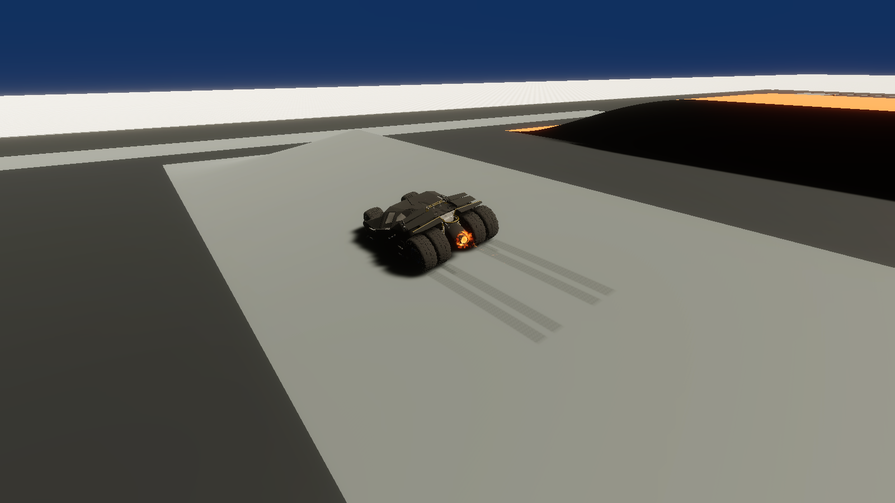
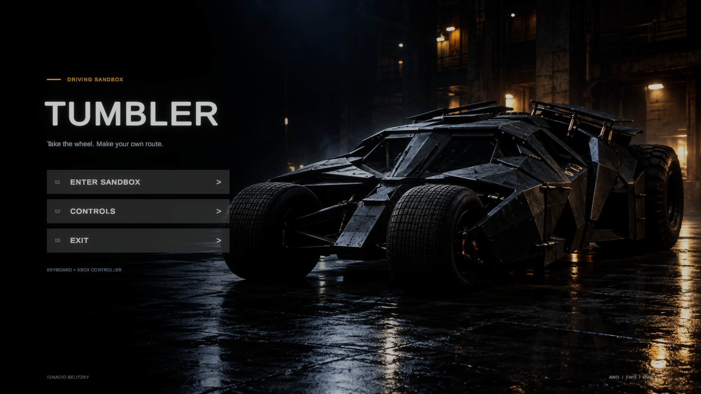

# Contact marks, menu colors and exposure

Available on `main`. The temporary review branch has been integrated and removed. This change follows the driving ground introduced in `33d9aaf`.

## Per-wheel contact marks

`TumblerEffects` now samples every wheel during physics updates. It reads `WheelCollider.GetGroundHit`, actual contact-point speed, lateral slip and braking slip while brake torque is applied. Sliding sideways can produce a mark with both brake and handbrake released. Coasting, very low speed and airborne wheels produce no marks. Slip magnitude is used when braking to handle either travel direction and the sign observed in the upgraded Editor.

`SurfaceSkidmarks` deposits one bounded world-space mesh. Each strip's center and edges are projected onto the actual contacted collider, including slopes and uneven ground. A small normal offset prevents flicker. The original six per-wheel widths are retained. Strokes break on lost contact, released slip/braking, changed colliders, resets and large discontinuities. Already deposited marks stay on the ground when the vehicle moves or rolls.

The HDRP-only shader gently darkens the underlying surface with soft edges and fine longitudinal variation. Maximum input opacity is **0.24**; the shader further softens it at edges/grooves. Marks last at most **25 seconds**, fading over the final **8 seconds**. The mesh holds **2,048 segments**, overwriting the oldest when full. A continuous high-speed skid can therefore replace old segments before their lifetime expires. There is one mesh/material, with no new object or material allocation per mark.

The four rear smoke systems remain and emit from their wheel contacts during stronger slip. Their emission rate uses physics time, and existing particles remain in world space. Moving dynamic props are excluded from permanent road marks.

Tuning is available on **Tumbler → Tumbler Effects**: minimum contact speed (1.5 m/s), slip thresholds, opacity, lifetime, fade duration, sample spacing and offset. Vehicle geometry, wheel colliders, torque, suspension, steering, drivetrain, input actions and braking forces are unchanged.

The six old camera-facing TrailRenderers and their unreferenced legacy shader, material and PSD were removed after checking retained asset references. Their transform anchors remain for the existing particle hierarchy.

Unity documents the contact point/normal and the slip fields used for effects in [WheelHit](https://docs.unity3d.com/ja/current/ScriptReference/WheelHit.html).

## Stable Sandbox exposure

Sandbox has a **Sandbox Exposure** global Volume with priority 10 and its own profile at `Assets/_Project/Rendering/SandboxExposure.asset`. It overrides only exposure mode and fixed exposure, set to **EV100 12.5**. It does not alter the inherited global default profile or Main Menu.

This removes brightness pumping caused by automatic metering when the dark Tumbler, a sign, the sky or the bright terrain occupies a different part of the frame. Lighting, shadows and material reflections can still vary naturally with direction. To tune brightness, edit **Fixed Exposure** in this scene profile; a larger EV value darkens the image. See Unity's [exposure reference](https://docs.unity.cn/Packages/com.unity.render-pipelines.high-definition@17.0/manual/reference-override-exposure.html).

## Consistent menu options

Enter Sandbox now shares the other options' neutral button palette, text color, number and arrow colors. Keyboard/controller selection uses the same neutral palette with a stronger opacity. Layout, wallpaper, navigation references, scene-loading and button callbacks are retained.

## Validation and captures

Native checks in Unity **6000.6.7f1** / HDRP **17.6.0** cover:

- Matching menu label and button colors, and retained Enter Sandbox callback.
- Scene-local fixed exposure and the resolved HDRP Volume stack at multiple camera angles.
- Actual Tumbler braking contacts, lateral sliding with both brakes released, projected vertex heights on asphalt and camber, airborne gaps and world-space persistence after repositioning.
- Shader support/compilation on Vulkan, the opacity limit and inspection renders before/after expiration.
- The existing driving-ground contact and grip checks.

The physics trials use controlled vehicle velocities/brake torque and temporary restraints; they do not claim a physical keyboard/controller driving session. Inspection cameras temporarily disable motion blur to make marks readable. Those camera and blur changes are not saved into gameplay. The native Editor also logs an unrelated Search indexing exception; physics assertions and renders complete successfully.

Repeat the contact/exposure/menu checks with the project closed in Unity:

```sh
python3 tools/verify-visual-effects.py --unity /path/to/Unity --graphics
```

Without `--graphics`, the helper checks native physics and scene state without GPU renders. Reports go to ignored `TestResults/VisualEffects/`. The temporary verifier is removed afterward; scene files are checked for accidental writes and the original font asset is restored if TMP changes its atlas. Personal driving, performance profiling and player builds remain unverified.




