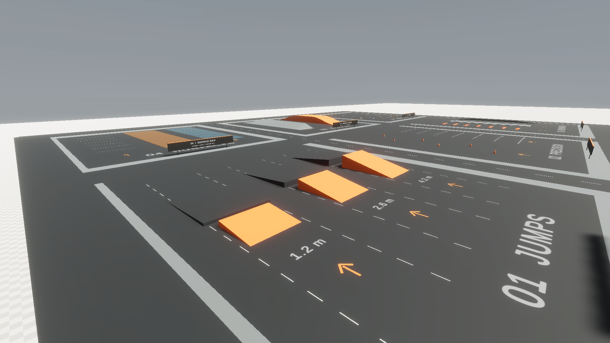
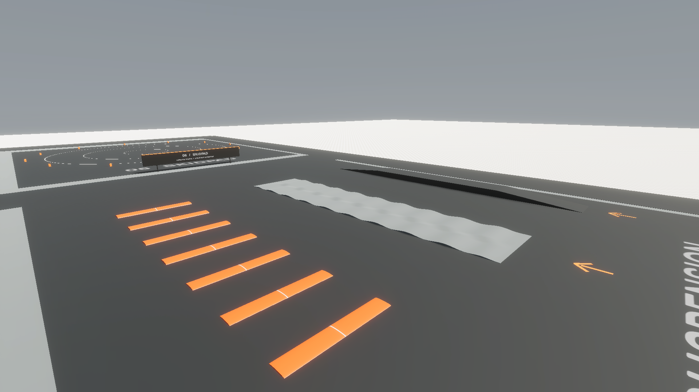

# Sandbox driving test ground

Branch: `feat/tumbler-underbody-detail` — continues the approved Tumbler visual work.

This document records the ground addition in `33d9aaf`. Subsequent [contact-mark and exposure updates](contact-marks-and-exposure.md) revise the visual effects and add a scene-local exposure Volume.

Scene: `Assets/_Project/Scenes/Sandbox.unity`

Unity: `6000.6.7f1` / HDRP `17.6.0`

## Finding the new ground

From the original spawn, follow the amber arrows left to the access road at X = -50, then drive north (+Z) to the **DRIVING TEST GROUND** gateway. The new facility occupies X = -159…159 and Z = 145…395. The original spawn `(0, 1, 40)`, reset location and playground obstacles remain in place.

Each area has a numbered sign, ground title, approach space and surrounding access roads. All dimensions below are world-space meters. These are initial vehicle test fixtures, without race rules or automatic timing.

| Area | Approximate location | Fixtures and intended use |
| --- | --- | --- |
| 01 — Progressive jumps | X = -145…-65, Z = 160…260 | Three 12 m wide launches at 1.2 / 2.6 / 4.2 m height, with 2 / 3 / 4 m gaps before separate 16 m wide landing ramps. Approach from the south. Start slowly on the smallest ramp. |
| 02 — Precision | X = -40…40, Z = 160…260 | Six movable slalom markers in the left lane. Right lane has a start line and braking-distance references every 10 m, through 60 m. |
| 03 — Suspension | X = 65…145, Z = 160…260 | Seven progressively taller speed bumps (0.10…0.28 m), an alternating 57 m uneven track and a 5.6 m wide bridge raised 1.4 m. |
| 04 — Surface grip | X = -145…-65, Z = 280…370 | Parallel 70 m lanes: asphalt at X = -130, rough gravel at -105 and wet low grip at -80. Gravel includes small modeled height variations. |
| 05 — Weight transfer | X = -40…40, Z = 280…370 | A 12° cross slope with eased entry/exit at X = -20. A 5.2 m hill with ascent, crest and descent at X = 20. |
| 06 — Skidpad | X = 65…145, Z = 280…370 | Turning circles of 8 / 21 / 32 m radius, centered on `(105, 0, 332)`, with perimeter markers. |

The jumps have different approach/landing requirements. They have not been calibrated to guarantee a landing at a particular speed. The open ground between launch and landing remains available for recovery.

## Surface response

`DrivingSurface` marks a collider's grip profile. The `WheelSurfaceGrip` component on the test-ground root references the existing Tumbler through a scene override. It samples each wheel's actual ground contact and scales the original longitudinal/lateral friction **stiffness** independently:

| Surface | Forward multiplier | Sideways multiplier |
| --- | --- | --- |
| Asphalt, ramps and unmarked ground | 1.00 | 1.00 |
| Gravel lane | 0.72 | 0.58 |
| Wet low-grip lane | 0.55 | 0.35 |

These values are tunable test profiles, rather than measured real-world coefficients. The wet lane does not simulate water, and the gravel does not simulate loose particles.

WheelCollider friction ignores standard collider physics materials. The adapter follows Unity's documented contact-based approach: query `GetGroundHit` and modify wheel friction based on the contacted surface. See [Unity WheelCollider.GetGroundHit](https://docs.unity.com/en-us/engine/6000.0/script-reference/unityengine/wheelcollider/getgroundhit).

Only stiffness is written, using the current curves. The controller's braking/handbrake slip adjustments remain available. All six wheels are evaluated independently, including mixed-surface contacts. Original stiffness is restored when a wheel leaves the marked surface, loses contact, or when the adapter is disabled. Reenabling captures the restored baseline.

## Editing or disabling the facility

The scene adds one root instance of `Assets/_Project/Prefabs/DrivingTestGround.prefab`. Seven children organize access plus the six test zones. Geometry, seven HDRP materials, markings and signs are local to the new ground; the speed-bump mesh/material are reused from the existing playground. Painted markings and text have no colliders. The six slalom markers are dynamic; other new fixtures are static.

To compare the original driving response everywhere, disable **Wheel Surface Grip** on the scene's **Driving Test Ground** root. To hide the complete addition, disable that root. Disabling also restores tire stiffness. To tune a lane, edit its **Driving Surface** forward/sideways values. These values do not modify the vehicle's original serialized setup.

All pre-existing Sandbox object blocks are preserved exactly; only a root prefab instance and its scene-root entry were added. The original Tumbler source mesh, proportions, approved underbody geometry, colliders, suspension, Rigidbody, drivetrain/gearbox/boost code, controls, HUD, effects, cameras and lighting are unchanged. Main Menu, packages and project settings are unchanged by this addition.

## Validation

The committed [validation report](driving-test-ground-validation.json) records native scene-load, contact and Play Mode checks. The actual six-wheel Tumbler was placed on each surface during the grip checks; temporary restraints isolated stationary contact from lateral motion. Checks cover baseline restoration, disable/reenable and preservation of the existing handbrake slip change. This is a contact/behavior check, not a timed driving comparison.

To repeat the native checks, close the project in Unity, then run with its matching installed Editor:

```sh
python3 tools/verify-driving-ground.py --unity /path/to/Unity
```

The helper installs a temporary Editor-only verifier, runs Sandbox in batch Play Mode, removes the verifier and preserves the original font file if TMP updates its dynamic atlas. Results go to ignored `TestResults/DrivingGround/`. No test assets or scene changes are saved.

Manual acceptance in Play Mode:

1. Follow the arrows from spawn and confirm the Xbox/keyboard controls, camera and HUD feel as before.
2. Repeat acceleration, braking and handbrake maneuvers at comparable speeds on each grip lane; tune profiles if needed.
3. Test the smallest jump first, then increase approach speed and ramp size. Check suspension travel, landing and recovery.
4. Cross the bump series and uneven lane at several speeds. Try the bridge, cross slope and hill in both directions.
5. Use the skidpad to compare steering circles and AWD/FWD/RWD behavior. Hit a slalom marker to confirm it can move.
6. Test reset, upright recovery and boost after an obstacle impact. Review performance on the target PC.

Physical controller driving, timed stopping distances, repeated landing reliability, audio evaluation, performance profiling and player builds remain for personal testing. The batch run also logged an unrelated Unity Editor Search indexing exception; the native physics assertions completed successfully.

## Native HDRP captures

These views use temporary overview/inspection cameras and fixed preview exposure. The gameplay camera and scene lighting were not saved with those changes.





