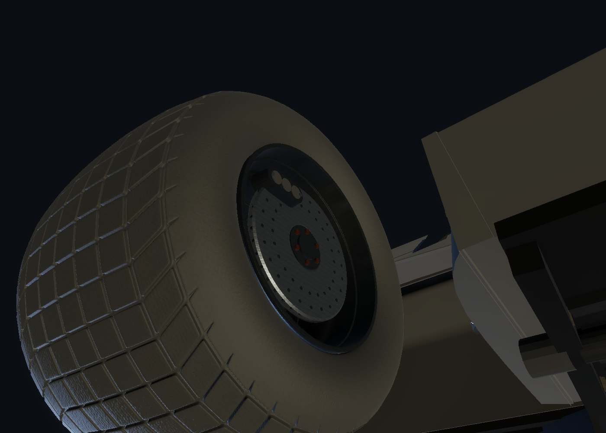
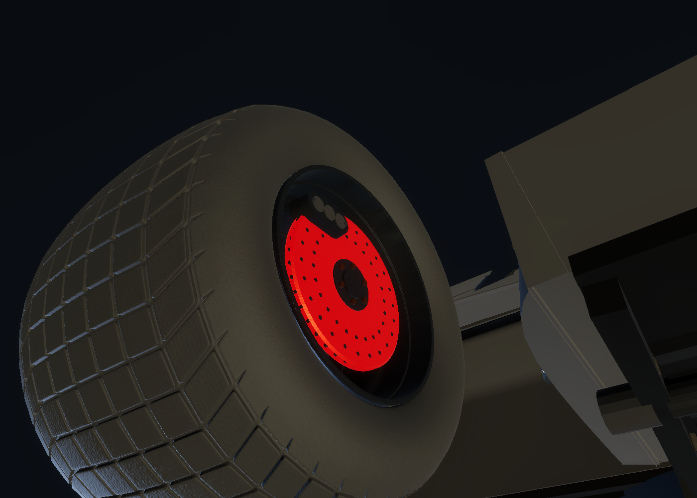
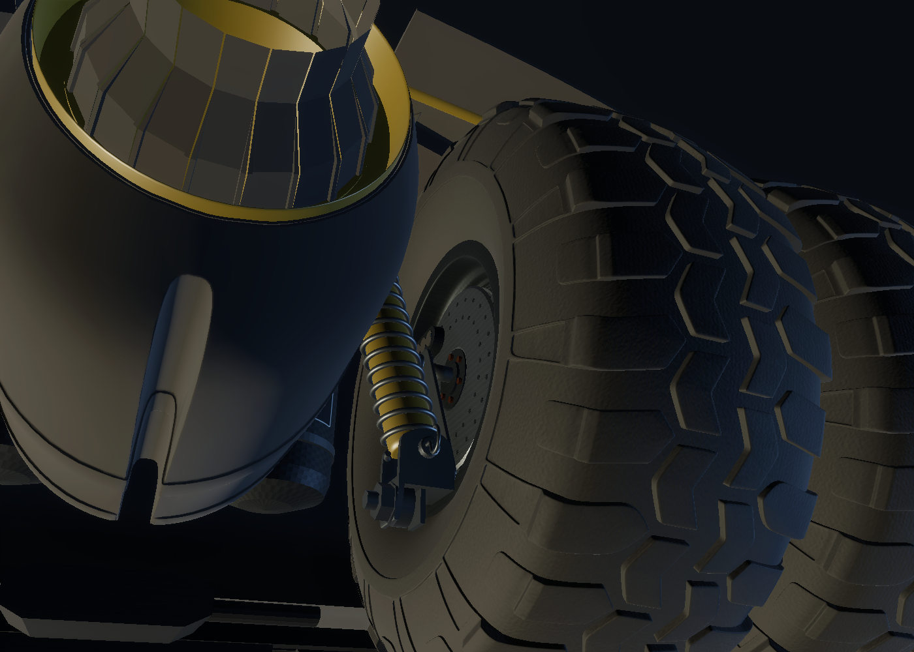
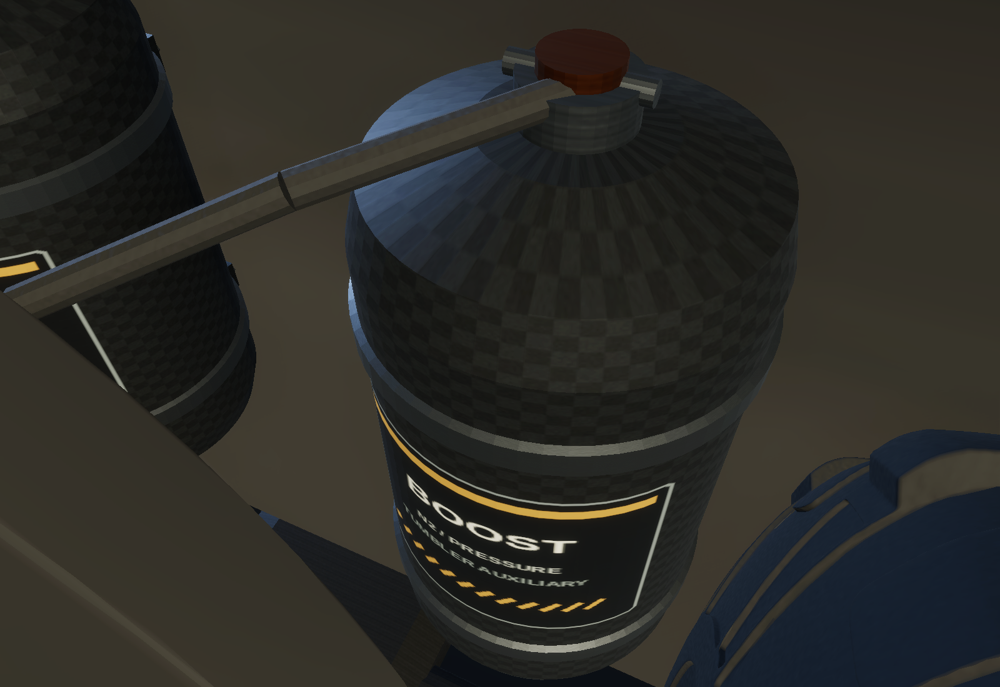
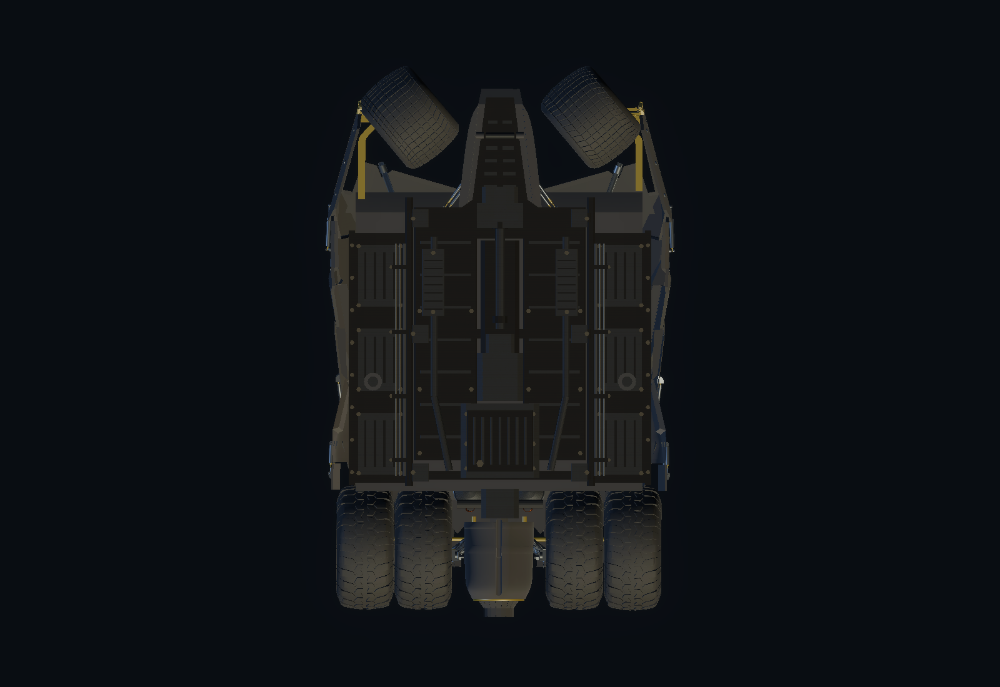
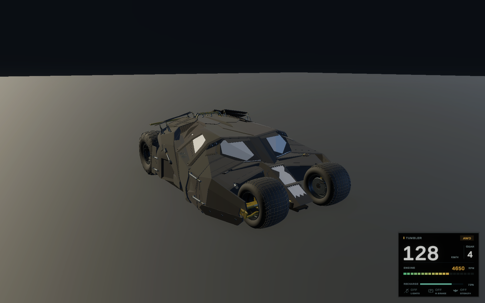

# Tumbler equipment and night systems

Review branch: `feat/tumbler-lighting-stealth-and-detail`, based on the approved `main` vehicle update. Main Menu, source FBX, body proportions, wheel colliders, suspension, grip, transmission, steering and the 260 km/h governor are retained. The active body mesh removes only the two old tank assemblies, including their valves and collars. The changes are wired in `Assets/_Project/Scenes/Sandbox.unity`.

## Visual equipment

- The front floor addition tapers into the stock nose instead of extending wide rails beside the front tires. The original front body shape and collision hull are untouched.
- All eight stock lamp surfaces receive fitted optical overlays with prismatic normal, base, mask and emission maps. Four upper lamps supply low beam; high beam uses all eight with a longer, narrower beam. HDRP spotlights use soft cone falloff, shadows and a local forward volumetric haze. Daylight exposure remains fixed at EV100 12.5; beams are naturally more visible in shadow/dusk than in direct sunlight.
- Six smaller sports-style gray rotors have circular beveled friction rings, ventilated edges, round drilled detailing, dark hubs, bronze fasteners and separate rounded fixed calipers. The rotor radius is 69% of the stock rim radius, approximately 389 mm front / 430 mm rear diameter. All six assemblies mount on the inner wheel faces toward the chassis, including the inboard faces of both tires in each rear pair. The earlier recessed mounts are mirrored across each wheel center; the discs sit approximately 44–56 mm inside the inner rim extremity. Calipers move with them and their detailed faces point inward. The tire and rim surfaces use molded-rubber and brushed gunmetal PBR maps.
- Two inner boost pressure tanks replace the old assemblies in the same interior bays. Composite shells, retaining bands, valves, protected hoses and service stencils are separated from the rear coil-over shock absorbers and turbine. A 95 mm rearward / 35 mm lower adjustment and narrower shells provide body clearance without changing the surrounding vehicle geometry.
- Both existing upper fuel caps are bronze. Shared lower-chassis hardware gains restrained machined-metal texture.

The texture sources are deterministic 512 px PBR maps produced by `tools/night-systems/generate-textures.py` (Python, NumPy and Pillow). The original FBX and all six wheel meshes stay unchanged. `TumblerBodyImporter` builds the active body from a small `.tumblerbody` definition: the material group containing only the old tank assemblies is removed, retaining every other body vertex, normal, UV and triangle. The definition checks the source FBX hash and triangle count; if the FBX is edited, re-author this derivative rather than applying an obsolete selection. This avoids storing a large duplicate body mesh. New equipment has no additional colliders.

## Controls and behavior

| Action | Xbox | Keyboard |
| --- | --- | --- |
| Cycle off / low / high | D-pad Up | L |
| Toggle Bat stealth | Right stick click | V |
| Turbo / exit stealth | A | Left Shift |
| Service brake, all six wheels | B | Left Ctrl |
| Handbrake, rear four wheels | X | Space |

Light and stealth controls react once per press. While stealth is active, cycling lights has no effect on the stored preset. Exiting restores that preset and each engine source's previous mute state. The running loops continue silently to preserve RPM/gear synchronization. Tire/road sounds remain physical sounds rather than engine layers.

Stealth immediately clears turbine flame/embers/smoke and disables vehicle lights, optical emission and brake incandescence. Physical brake heat continues to cool normally and becomes visible again after leaving stealth. The engine still drives the vehicle. A fresh turbo press has priority over entering stealth and exits it even with zero reserve; leaving stealth by stick/key restores ordinary turbine effects without forcing the boost flame on.

Turbo defaults: six seconds of use, 2.5 seconds of recharge delay, twelve seconds from empty to full on the ground, 2.5 times faster in the air. Any of the six wheels touching a surface counts as grounded. The HUD shows the remaining percentage and changes the bar color while consuming or recharging; airborne refill is cyan. Exhausting the reserve requires a button release before boost can resume, avoiding rapid bursts while the button is held.

Each rotor heats from its own WheelCollider brake torque while the vehicle or airborne wheel is moving. Thus service braking can make the front pair glow as well as the rear four, and handbrake-only use leaves the front pair cold. Gray steel gradually turns deep red and then orange-red under sustained braking; it cools after release. This is a visual heat approximation, without brake fade or altered stopping forces. Stationary braking does not generate heat.

## HUD

The existing digital speed, gear, drivetrain and colored RPM block stays at bottom-right. A 64 px footer adds turbo reserve and vector off/low/high lamp, handbrake and Bat indicators. Total reference size is 300 × 240 px on a 1920 × 1080 canvas; it scales with resolution and respects the existing safe-area margin.

## Verification

Native Unity 6000.6.7f1 validation of the inboard mounts passed **112 edit-mode and 59 Play Mode assertions**. The earlier feature commit also passed **82 edit-mode and 64 Play Mode handling regressions**, retained as baseline results. This mount-only adjustment leaves runtime scripts, geometry assets, rigidbodies and colliders unchanged. The [complete results](tumbler-night-systems/validation.json) include the virtual keyboard/Xbox inputs and original drivetrain/steering runs.

- Both tank shells pass a conservative hull check against the remaining body mesh, including the turbine and shocks. Their pressure lines also pass. The installed shells retain approximately 6.2 / 11.9 mm lateral clearance from the inner rear tires.
- Exactly 5,316 old tank/valve/collar triangles are removed; every other original body triangle, vertex, normal and UV stays identical. All six original wheel meshes remain unchanged.
- The new front-floor vertices clear inflated tire envelopes through ±40° steering and ±15 cm suspension travel, with a minimum measured separation of 102 mm. Sampled friction-ring probes find no body intersections at the tested steering/suspension poses. All six discs are verified on the inner side of the wheel center; conservative caliper boxes also clear body/suspension surfaces at those poses.
- Actual per-wheel service/handbrake torque, production thermal updates, cooldown, stationary brakes, hidden heat during stealth, non-spinning calipers, reserve exhaustion/re-arming, delayed/airborne refill, light presets and empty-reserve stealth exit all pass.
- FWD, RWD and AWD each reach seventh gear and approximately 260.04 km/h in the native physics regression. Existing steering, reset, braking and RPM/audio-pitch assertions pass.
- Native Vulkan HDRP renders verify the optics, gray/red rotors, fitted tanks, steering clearance and HUD at 720p, 1080p and ultrawide. The actual render-request camera resolves volumetrics enabled with volumetric fog enabled. The gameplay camera uses the same default HDRP frame settings.

Physical Xbox hardware, subjective driving/audio evaluation, performance profiling and a standalone player build still require manual testing. Unity's QuickSearch startup indexer emitted an editor-only exception during headless runs; the assertions and captures completed successfully.

These are native HDRP inspection renders with temporary lighting/cameras and staged dashboard values. Night-beam previews use a temporary dusk exposure; the authored Sandbox remains at EV100 12.5. [Low beams](tumbler-night-systems/lights-low.png), [high beams](tumbler-night-systems/lights-high.png) and the [720p HUD](tumbler-night-systems/hud-720.png) are also available.

The helpers are outside `Assets` so they do not become game code. To reproduce in a disposable project copy with Unity 6000.6.7f1:

1. Copy `tools/night-systems/*.cs` to `Assets/_NightAuthoring/Editor/` and let Unity compile.
2. Execute `NightSystemsVerify.Run` with `-batchmode -nographics -projectPath <copy> -executeMethod NightSystemsVerify.Run -logFile <log>`.
3. Execute `NightSystemsPreview.Run` with `-batchmode -force-vulkan` and a graphics-capable session for HDRP captures. Preview staging never saves its temporary lights, exposure, floor or camera.
4. Run the existing `TumblerUpdateVerify.Run` helper for drivetrain, steering, engine-pitch and input regressions.
5. Remove the temporary `_NightAuthoring` folder and its `.meta` before committing.

`AuthorNightSystems.Run` rebuilds equipment assets in a disposable copy. It preserves asset GUIDs but Unity may reserialize unrelated legacy scene data when saving; review the scene diff before keeping an authored result.

`MoveBrakeDiscsInboard.Run` relocates existing discs and calipers without rebuilding their meshes. It also updates the runtime caliper offsets; moving only the visible caliper transforms would be overwritten during play.

## Manual review checklist

1. Turn both front wheels fully left/right, compress the suspension and inspect the front floor for visible intersections.
2. Cycle all three lamp states with L and D-pad Up; compare low/high throw against a wall and in a shaded area.
3. Accelerate and repeatedly service-brake: all six discs should redden. Hold only the handbrake during a moving slide: only the four rears should heat. Stop and allow them to cool.
4. Check that calipers steer/travel with wheels but remain fixed as the discs spin.
5. Consume the turbo reserve, release the button, watch the recharge delay, and compare ground versus airborne refill.
6. Enter stealth from low/high lights while moving: lights, glowing rotors, turbine effects and engine audio should disappear; driving remains available. Exit with V/R3 and with a fresh boost press, including at empty reserve. The original lamp preset must return.
7. Inspect tank straps/valves/hoses, both bronze fuel caps, wheel rubber and rim finishes from several angles. Rear shock geometry should remain familiar.
8. Check speed/RPM/gear/drivetrain and all new status icons at the resolutions and aspect ratios used on your PC.
