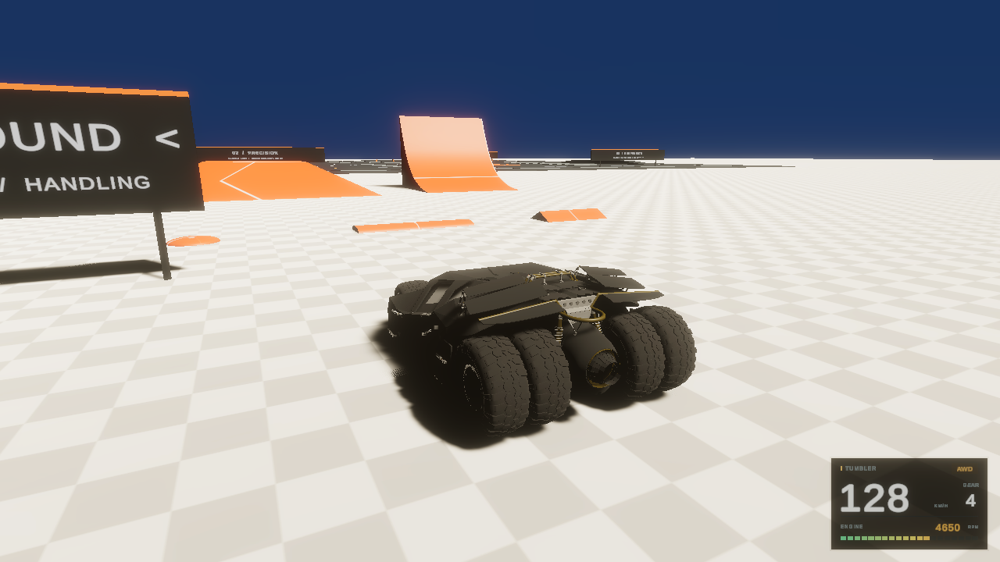
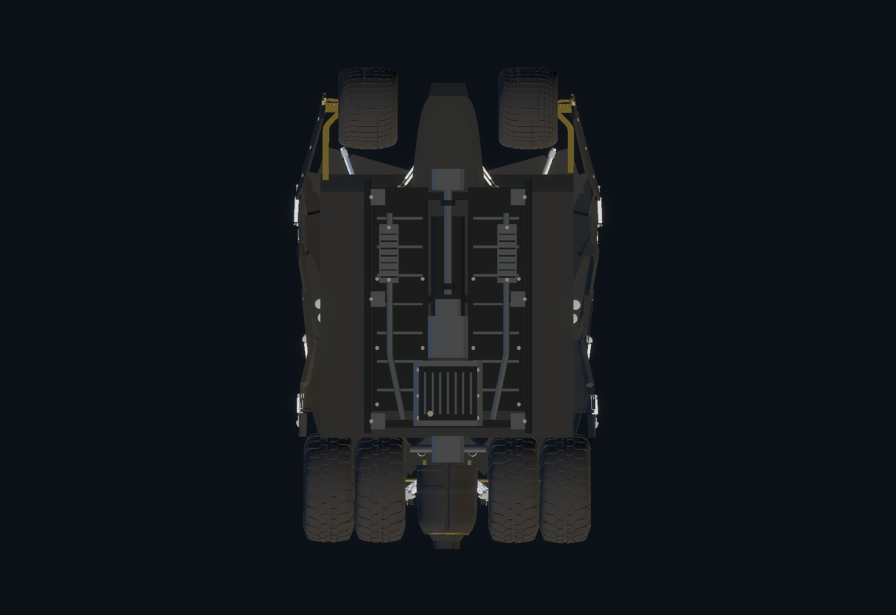
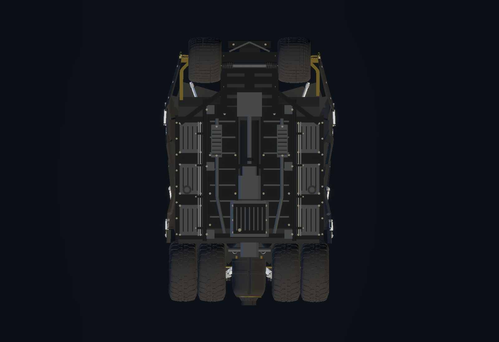
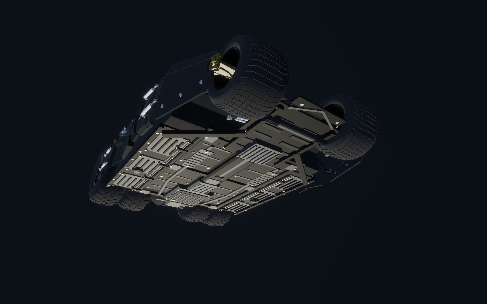

# Digital instruments, seven-speed drivetrain and extended underbody

Available on `main`. Baseline: `e36e977`.

## Balanced steering

The previous steering correction approached a one-degree limit at high speed, making the vehicle reluctant to turn. The existing wheelbase/speed model now includes a smooth four-degree high-speed allowance:

```text
limit = atan(wheelbase × acceleration allowance / horizontal speed²
             + tan(high-speed steering allowance))
```

The result is still capped by the original low-speed steering envelope and retains its smoothing. Sandbox uses a 4.513 m wheelbase, 9 m/s² acceleration allowance and 4° high-speed allowance. Parking steering remains 40°. This is game handling calibration; tire grip still limits the actual path and full steering at speed can create slip or reduce speed.

Paired, two-second full-steering tests with the new drivetrain compare the previous zero-allowance model with the balanced model:

| Initial speed | Previous heading change | Balanced heading change |
| --- | --- | --- |
| 60 km/h | 39° | 67° |
| 120 km/h | 16° | 42° |
| 180 km/h | 8° | 29° |
| 240 km/h | 5° | 27° |

These are body-heading changes under controlled conditions, not guaranteed corner radii or fixed-speed handling measurements. The vehicle remains free to move and lose speed during each turn.

## Seven forward gears and speed governor

The previous five-entry, speed-scaled RPM model is replaced by seven ratios: **5.8, 4.0, 2.9, 2.25, 1.8, 1.4, 1.08**, with a 5.7 final drive. Automatic upshifts use 6600 road-coupled RPM, downshifts use 3200 RPM, and a 0.45 s cooldown prevents rapid hunting. A short 0.18 s torque reduction represents the change. Stopping allows the gearbox to return to first. Reset also clears wheel spin and returns the engine/gearbox to idle and first gear.

The simulated engine idles at **900 RPM** and has a **7200 RPM** instrument limit. RPM follows the road/wheel coupling in the selected gear, including wheel spin. During a shift, the road coupling is used while the clutch delivery is reduced. Upshifts immediately reduce engine RPM according to the new ratio, then the shared engine state continues smoothing toward its coupled value. This is a simplified game drivetrain, not measured Tumbler engine data.

The forward governor is **260 km/h**; reverse is limited to **80 km/h**. Speed and the digital speedometer use horizontal velocity so falling speed does not inflate the reading. The governor preserves vertical movement for jumping/falling and also applies while using boost. Native straight-line tests reach approximately 260.04 km/h in all three drivetrain modes without boost, with seventh engaged. The small numerical overshoot occurs within a physics step.

Available engine torque is distributed over the selected driven wheels and compensated for the different front/rear tire radii. It is no longer multiplied by selecting more driven wheels. Peak forward engine torque is configured at 1400, with an 18000 N drive-force delivery ceiling. Tire grip, suspension, body mass, center of mass, inertia, colliders, braking, handbrake forces and existing input bindings are retained. Surface profiles continue to scale tire friction.

## RPM-synchronous audio

The original engine/startup/idle/tire clips remain. Running pitch now follows `GetNormalizedEngineRPM()` rather than absolute vehicle speed, ranging from 0.65 at idle to 1.8 at the RPM limit. Idle/running levels crossfade with engine revs. The HUD reads the same engine RPM state. Native measurements confirm that every upshift reduces both RPM and pitch. Listening on the target PC remains part of personal acceptance.

## Compact digital HUD

`Assets/_Project/Prefabs/DigitalVehicleHUD.prefab` replaces the analog dial and needle. The 300 × 176 panel sits at the bottom right with 24 reference pixels of margin and safe-area inset handling. The Canvas scales from a 1920 × 1080 reference resolution.

The graphite panel contains a large speed value, KM/H units, the current forward gear or **R**, and an **AWD/FWD/RWD** chip. A numeric RPM value and twenty tachometer segments progress through green, yellow, orange and red. Only the engine instruments change RPM color; speed stays neutral for readability. The HUD images do not intercept pointer input. Existing gear/drivetrain Unity events still target `UIController`; serialized references connect that adapter to the new view.

The old analog GameObjects, needle-update code, and the exclusively referenced `dial 1.png` / `needle.png` assets and metas are removed after a project-wide reference check. Other HUD/menu imagery is retained.

These native HDRP layout previews use representative instrument values on a stationary scene; the speed-governor results above come from separate physics runs.




## Extended mechanical underside

The approved five original detail groups remain. One additional visual-only prefab, `TumblerUnderbodySystems.prefab`, fills the outer floor and front-center areas:

- Side floor stampings with formed beads, sill rails, removable panels and fasteners.
- Front subframe braces, ribbed sump cover, steering-rack housing, bellows, tie rods and leading skid trim.
- Brake/service lines, retaining clips, insulated mounts and metal hardware.

Three combined meshes add approximately 3300 triangles using the existing graphite/alloy/zinc palette and one matte rubber material. The original FBX, wheel/exterior geometry, proportions, original detail meshes and materials remain unchanged. New pieces remain inside the original vehicle render envelope. No additional physics colliders are added, preserving the underbody glide fix.

Studio images use temporary inspection lighting and cameras; gameplay exposure and lighting are retained.

Before the extension:



After:





## Verification

Close the project in Unity, then use the matching Editor:

```sh
python3 tools/verify-tumbler-update.py --unity /path/to/Unity --graphics
python3 tools/verify-driving-ground.py --unity /path/to/Unity
python3 tools/verify-chassis.py --unity /path/to/Unity
```

The current vehicle helper covers scene assets, HUD sizing/text/colors, seven-speed acceleration in FWD/RWD/AWD, RPM/pitch drops, shift cooldown, braking to first/idle, reset, keyboard/Xbox virtual inputs, proportional/parking/reverse steering, both-direction sustained turns, boost/governor behavior and vertical-velocity preservation. Optional GPU checks render eight HUD/underbody inspection images. Reports go to ignored `TestResults/TumblerUpdate/`. The helper removes temporary scripts and preserves the original scene and dynamic font asset. `verify-handling.py` delegates to this current suite; the superseded steering-only verifier is removed, while historical validation reports remain unchanged.

The [validation report](tumbler-upgrade-validation.json) records measured runs and preservation checks. The existing contact/grip and chassis suites are also rerun. Physical-controller driving, exhaustive obstacle coverage, performance profiling, player builds and subjective audio evaluation remain manual checks. An existing Unity Editor Search indexing exception can appear independently of the native assertions.
