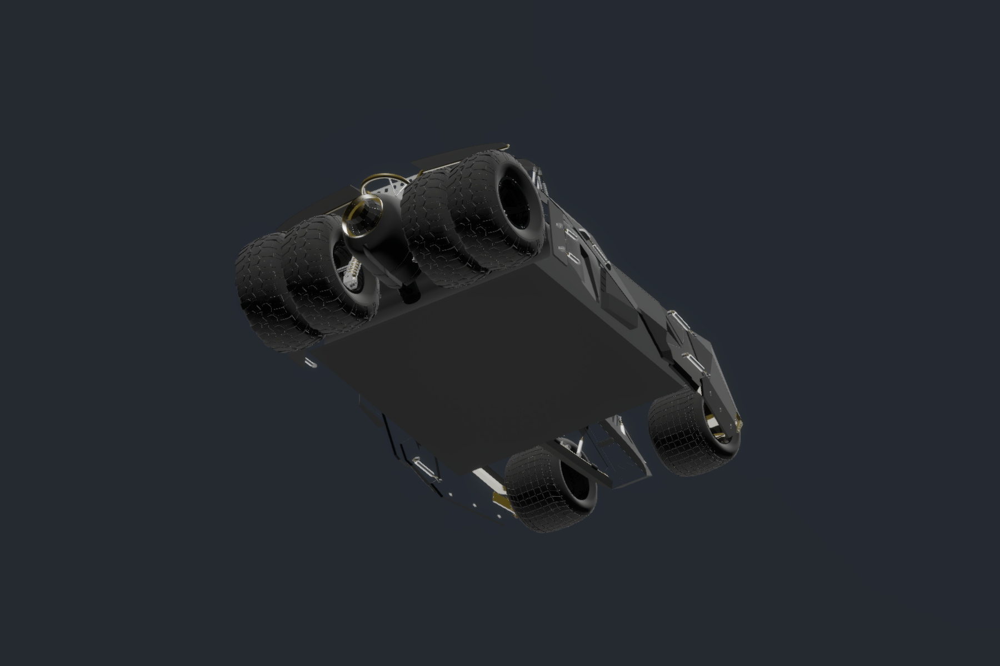
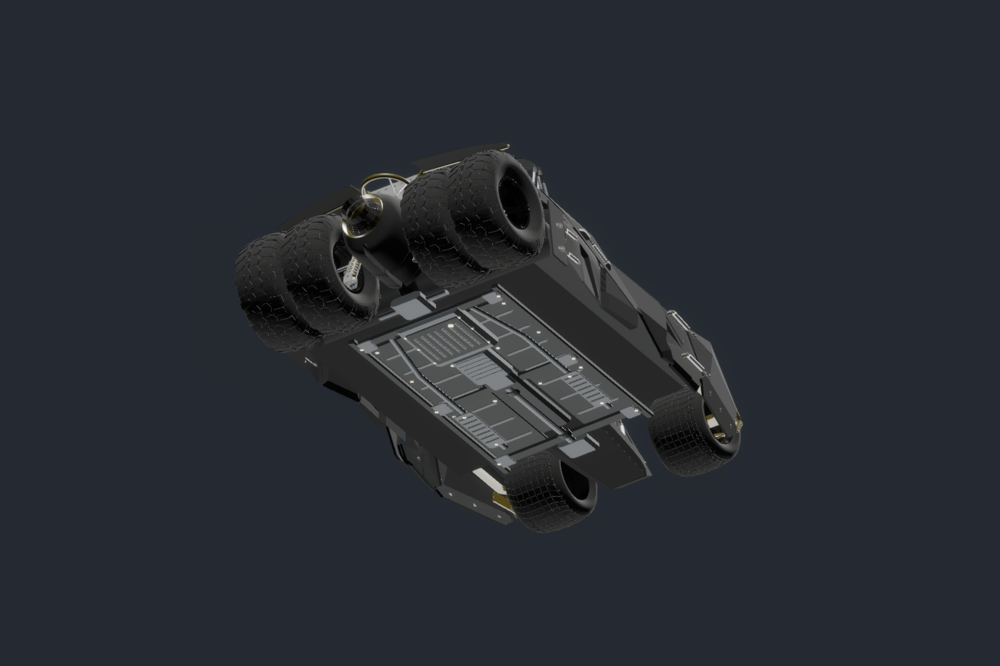

# Tumbler visual pass — review branch

Branch: `feat/tumbler-underbody-detail`

Baseline main: `483ae13b648b21638287e2dbbbd15bd5cdef69bb`

Unity: `6000.6.7f1` / HDRP `17.6.0`

## Original geometry remains intact

`tumbler_v7.fbx` and its importer meta are unchanged. No original vertices, triangles, normals, pivots, transforms, wheel meshes or proportions were edited, welded, rescaled or regenerated. The original materials embedded in the FBX also remain unchanged.

Sandbox changes only the Body renderer's six material references and adds one child prefab to Tumbler. All other original scene object blocks, including vehicle settings, wheel transforms, colliders, suspension, Rigidbody, audio, particles and UI/input callbacks, retain their original serialized contents. Main Menu, project/package settings and C# gameplay code are unchanged.

## Backface visibility

The original Body materials use backface culling. Six separate material variants enable HDRP double-sided rendering with **Flip** backface normals. Only the Body renderer uses these variants; wheel materials retain their original references. The front-face colors, textures and original mesh data are retained.

This addresses thin surfaces disappearing when viewed from behind/inside without rebuilding the realistic exterior. It does not create physical wall thickness or a new modeled cockpit. See Unity's [double-sided material explanation](https://docs.unity.cn/Packages/com.unity.render-pipelines.high-definition%408.0/manual/Double-Sided.html).

## Reversible underbody relief

`Assets/_Project/Prefabs/TumblerUnderbody.prefab` adds a molded mechanical relief beneath the existing flat base, with a restrained die-cast-style finish:

1. Split stamped floor pans, reinforcement ribs and perimeter fasteners.
2. Boxed longitudinal rails, crossmembers and mounting plates.
3. A central transmission tunnel, ribbed gearbox housing and driveline.
4. A rear engine/sump casting, cooling ribs, drain plug and differential relief.
5. Paired pipes and ribbed heat shields.

The original base plate remains. The five added mesh groups total **4,380 triangles** and use three finishes: graphite steel, cast alloy and zinc hardware. The relief was fitted below the measured original base plane (approximately local Y = -0.6925) and remains inside the original vehicle's render envelope. It adds no colliders, Rigidbody, scripts or functional engine/gearbox behavior.

## Review in Unity

1. Fetch and check out `feat/tumbler-underbody-detail`; do not merge to main yet.
2. Open with Unity `6000.6.7f1` and open `Assets/_Project/Scenes/Sandbox.unity`.
3. In Scene view select `Tumbler`. Inspect its underside and look at the armor from inside/outside.
4. Toggle **Tumbler → Underbody Detail (Visual Only)** to compare the new relief with the original flat base. Individual mesh groups can also be toggled.
5. Check driving, ground clearance appearance, steering/suspension travel, vehicle rollover/recovery, boost/particles and audio in Play Mode. The added detail follows the vehicle automatically as a child; it does not change physical collision geometry.
6. For a complete original-material comparison, use main: disabling the detail prefab alone intentionally retains the backface visibility fix.

## Validation actually performed

- Full Sandbox scene reimport/reload in the correct Editor version.
- All seven original mesh references and vertex counts retained; original wheel materials retained.
- Six WheelColliders and the original single Rigidbody retained; no physics/behavior components in the new prefab.
- Every added renderer's bounds fits within the original vehicle envelope.
- All Body variants report double-sided enabled and culling disabled.
- Before/after views rendered from real project meshes through HDRP with identical studio camera/light setups. These are comparison renders, not AI illustrations or gameplay captures.
- Static file/scene comparison confirms original FBX/importer, gameplay code, physics components, settings and all unrelated assets remain unchanged.

Manual driving, physical controller testing, frame-rate profiling and player builds were not run for this visual pass. The branch is intentionally provided for personal acceptance testing.

## HDRP comparison renders

Before:

After:

